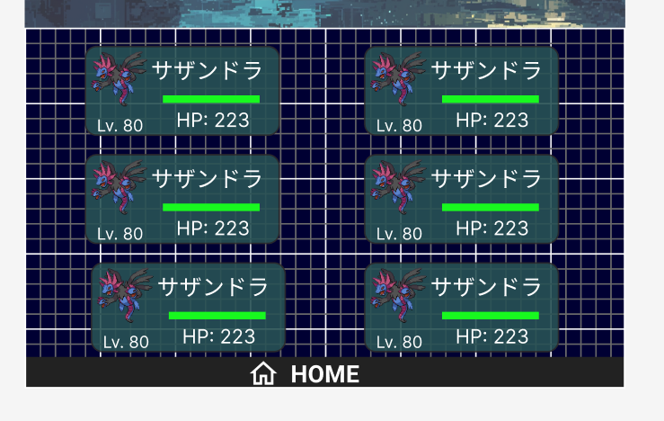

# Claude

## 重要

- 応答は日本語でお願いします.
- 不明点は毎度質問をお願いします.
- 作業内容は適宜Gitにて管理をお願いします(ブランチは現在のまま, コミットを行っていただければ大丈夫です).
- コミットメッセージの形式: `prefix: コミットメッセージ(日本語)`
- ドキュメントをよく確認してください.
- 不要になったコメント・スクリプトは適宜削除してください.

## 内容

- /partyの実装をお願いします.
- ポケモンの名前, レベル, タイプ1, タイプ2(あれば), 正面画像, HP(実数値), HPバーを表示してください.
- 最大6体まで表示します.
- 以下の画像のようなレイアウト・配色を忠実に再現してください.
- 

## ドキュメント

- 特に以下の資料をよく確認して作業をしてください.
  - `/home/cs23017/poke-clone-v3/Documents/Claude.md`
  - `/home/cs23017/poke-clone-v3/Documents/UML/クラス図.drawio`
  - `/home/cs23017/poke-clone-v3/Documents/UML/シーケンス図.drawio`
  - `/home/cs23017/poke-clone-v3/Documents/UML/アーキテクチャ構成.drawio`
  - `/home/cs23017/poke-clone-v3/Documents/フロントエンド実装手順.md`
  - `/home/cs23017/poke-clone-v3/Documents/要件定義.md` 
  - `/home/cs23017/poke-clone-v3/Documents/APIエンドポイント.json`