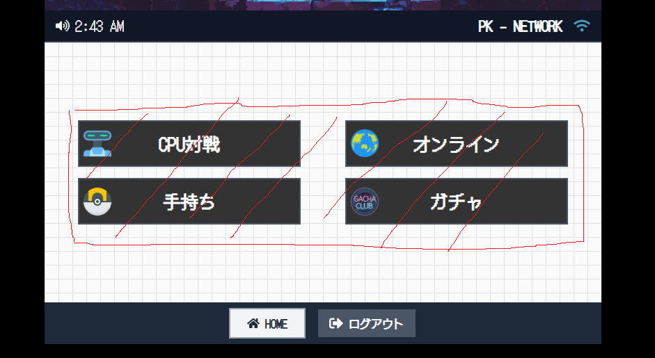

# Claude

## 重要

- 応答は日本語でお願いします.
- 不明点は毎度質問をお願いします.
- 作業内容は適宜Gitにて管理をお願いします(ブランチは現在のまま, コミットを行っていただければ大丈夫です).
- コミットメッセージの形式: `prefix: コミットメッセージ(日本語)`
- ドキュメントをよく確認してください.

## 内容
- 以下に入れるテキストとアイコンはJSONで設定できるようにしたい(/data/pages/config.jsonに追記してほしい).
- メニューボタン同士の間隔をもうすこし広くしたい.
  - 赤線の領域が格子模様の8割位になるのが理想.
  - 
- StatusBarの音量マークで音量調整できるようにしたい.
## ドキュメント

- 特に以下のドキュメントをよく確認して作業をしてください.
  - `/home/cs23017/poke-clone-v3/Documents/Claude.md`
  - `/home/cs23017/poke-clone-v3/Documents/UML/クラス図.drawio`
  - `/home/cs23017/poke-clone-v3/Documents/UML/シーケンス図.drawio`
  - `/home/cs23017/poke-clone-v3/Documents/UML/アーキテクチャ構成.drawio`
  - `/home/cs23017/poke-clone-v3/Documents/フロントエンド実装手順.md`
  - `/home/cs23017/poke-clone-v3/Documents/要件定義.md` 